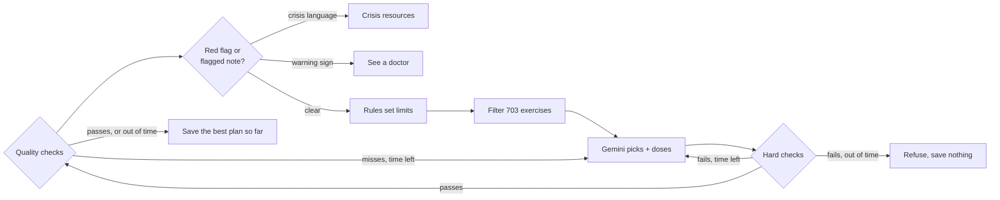

# Rebound

An AI coach that keeps athletes training instead of sidelined — no doctor's referral, no insurance, no waiting.

## What this does

You answer a short questionnaire about what hurts. Rebound checks it's safe to give you a plan at all, works out hard limits from your answers, and has Gemini build a short exercise plan that has to stay inside them. Software, not the AI, has the final word on every number.

Step by step:

1. **Pick or create an account.** These are test accounts: a username, no password.
2. **Answer four short steps:** where it hurts and how badly, seven yes/no warning-sign questions, your age, activity level, equipment and session length, and an optional note.
3. **The server decides one of three outcomes:**
   - **See a doctor:** any warning sign, or a note that mentions one, means no plan is generated.
   - **Crisis support:** self-harm language in the note goes to crisis resources, never to a plan or a doctor referral.
   - **Ready:** you're shown your limits and the reasons for them, e.g. "your pain is 7 or above".
4. **Rules set the limits.** Nine rules each look at one answer and can only lower a ceiling (sets, reps, hold time, number of exercises, difficulty, stretching vs strength). They stack.
5. **The library is filtered.** 703 exercises are narrowed by body area, your equipment, your level, the kinds of exercise your limits allow, and the movements you said make it worse. The page shows the count left after each step.
6. **Gemini picks and doses.** It is shown up to 20 of what's left and picks 2–5 with sets, reps or hold times, plus one line on why each suits you.
7. **Every plan is checked before it's saved, in two tiers.**
   - **Hard checks:** every number is inside the limits, every exercise was one it was given, and no rationale says to push through pain or claims to heal anything. A plan that fails is never saved.
   - **Quality checks:** criteria taken from published sources (AAOS, APTA, ACSM, credited in [`apps/server/eval/REFERENCES.md`](./apps/server/eval/REFERENCES.md)). For example, a knee plan should include something for the quadriceps or hamstrings. A criterion only counts when the limits allow it and one of the candidates could meet it.
   - **What happens on a miss:** Gemini is told exactly what was wrong and tries again, for up to 20 seconds in total. If time runs out, the plan that passed the hard checks with the fewest quality misses is saved. If none passed, nothing is saved and you're asked to try again later. Nothing is quietly patched.
8. **You get the plan:** each exercise with start and finish photos, numbered steps, its dose and its rationale, and the limits it was built inside. You can edit doses or delete it.



The original single-endpoint request path is drawn in [`diagrams/request-flow.svg`](./diagrams/request-flow.svg). It predates accounts and the questionnaire.

### Not built yet

- **No authentication.** An account is a uuid the browser remembers, and every request names it in an `X-User-Id` header.
- **`GET`, `PUT` and `DELETE /api/regimes/:id` don't check ownership yet.** The client hides other accounts' plans, but the server doesn't refuse them.
- **Edits are bounded by fixed ranges** (1–20 sets, 1–100 reps, 1–600s holds), not by the limits the plan was generated under.
- **No daily check-ins, streaks or weekly plan reviews.** See [Where this is going](#where-this-is-going).

## The API

Express on `:4000`. Errors are always `{"error": "..."}`. Routes marked 👤 need an `X-User-Id` header and answer `400` without one.

| Method | Path | Body | Success | Failures |
| --- | --- | --- | --- | --- |
| `GET` | `/health` | — | `200 {ok: true}` | — |
| `GET` | `/api/regions` | — | `200` region names | — |
| `POST` | `/api/users` | `{username}` | `201` user | `400` bad name · `409` taken |
| `GET` | `/api/users` | — | `200` every account | — |
| `GET` | `/api/users/:id` | — | `200` user | `404` |
| `DELETE` | `/api/users/:id` | — | `204`, and its plans and questionnaires with it | `404` |
| `POST` | `/api/onboarding` 👤 | answers + optional `freeText` | `201` `{id, outcome, screening, …}` | `400` names the expected values |
| `GET` | `/api/onboarding/:id` 👤 | — | `200` the saved outcome | `404`, including another account's |
| `GET` | `/api/onboarding/:id/candidates` 👤 | — | `200` `{query, funnel, candidates}` | `404` · `409` no plan from these answers |
| `POST` | `/api/regimes` 👤 | `{onboardingId}` | `201` plan | `404` · `409` no plan from these answers, or too few exercises fit · `503` generation failed, nothing saved |
| `GET` | `/api/regimes` 👤 | — | `200` this account's plans, newest first | — |
| `GET` | `/api/regimes/:id` | — | `200` plan | `404` |
| `PUT` | `/api/regimes/:id` | `{regime: [{id, sets, reps \| holdSeconds}]}` | `200` plan | `400` bad list or unknown exercise · `404` |
| `DELETE` | `/api/regimes/:id` | — | `204` | `404` |

`outcome` is `ready`, `see_a_doctor` or `crisis`. All three come back as a success, so a client must branch on `outcome`, never on the HTTP status. `POST /api/regimes` still accepts the original `{muscle}` body, which builds a plan with no questionnaire, held only to the widest limits.

A plan comes back as:

```json
{
  "id": "uuid",
  "muscle": "knee",
  "bodyRegion": "knee",
  "createdAt": "when it was generated",
  "updatedAt": "when it was last edited",
  "userId": "uuid",
  "limits": { "sets": {"min": 1, "max": 3}, "reps": {"min": 5, "max": 12}, "hold": {"min": 15, "max": 30},
              "count": {"min": 2, "max": 3}, "difficultyCap": "beginner", "categories": ["stretching", "strength"],
              "reasons": ["your pain is in the 4 to 6 range"] },
  "regime": [
    { "id": "Butt_Lift_Bridge", "name": "Butt Lift (Bridge)", "description": "Step one\nStep two",
      "unit": "reps", "sets": 2, "reps": 8, "holdSeconds": null, "rationale": "Why it suits you." }
  ]
}
```

`limits` is `null` on plans made before limits were recorded. `description` has one step per line, except on older plans.

Three decisions about plans worth knowing:

- **`PUT` takes ids and doses, never `name` or `description`.** A saved plan is the record of what the app told someone, so the server supplies that text itself.
- **An edit that changes a dose drops that exercise's rationale,** because the rationale explained the old dose.
- **A malformed id is a `404`, not a `400`,** so probing the API reveals nothing about how ids are shaped.

## Where this is going

What's above is the working core. The product it's being built into is bigger:

Rebound is meant to be a **mobile app** that keeps athletes training through nagging injuries instead of sidelined by them — no PT referral, no insurance, no waiting. The core idea is a twice-daily habit loop, like a workout version of a Duolingo streak:

- **Onboarding, once:** the safety screen and the starting plan. *This part is built.*
- **Two short sessions a day, every day:** a morning session bundled with a 10-second check-in (pain score, how it's feeling), and an evening session. Missing one doesn't break your streak; missing both does.
- **Every 7 days, the AI reviews your trend** and rewrites the plan: harder if you're improving, held steady if you're plateauing, backed off if you're getting worse.
- **A real-time safety layer runs underneath all of it.** A pain spike or a "this made it worse" flag triggers an immediate rollback to your last safe plan and a "stop and consult a professional" message, without waiting for the weekly review.

The whole bet is that most people don't need a clinician managing every decision. They need a plan that pays attention to them and adjusts, at a price and speed a clinician-staffed app can't match. That's also why the safety layer matters more here than in a normal fitness app: with no human backstop, the rules bounding what the AI may prescribe have to be solid before this could responsibly have real users. The onboarding half of that layer is built; the ongoing half (check-ins and rollback) is not.

## Team responsibilities

**Backend / API — Shahid Khan** (`apps/server`)
The Express server and its routes; input validation and error responses; the rules layer in `clinical.ts`; the candidate filters; the Gemini calls and the response schemas they enforce; the validator and retry; the migrations and the seed script; the tests.

**Frontend / UI — Syed Ahmed Ali** (`apps/client`)
The Next.js app: the landing page, account picker, questionnaire, outcome screens and plan pages; loading and error states; and how plans, limits and exercises are presented.

**Shared decisions — both**
The JSON shapes the API returns, since they are the contract between the two halves; the database tables; and the scope of each stage — what's working now and what comes next.

## Tech stack

**API** (`apps/server`)
- [Express 5](https://expressjs.com/): one controller per resource, one model per table
- [`pg`](https://node-postgres.com/): direct Postgres driver
- [`@google/genai`](https://github.com/googleapis/js-genai): Gemini calls, with JSON response schemas
- TypeScript, run via `tsx`

**Client** (`apps/client`)
- [Next.js 16](https://nextjs.org/) (App Router) and React 19
- One hand-written stylesheet (`app/globals.css`) with the colours as tokens: dark-first, one accent, 44px minimum tap targets
- Exercise photos from [free-exercise-db](https://github.com/yuhonas/free-exercise-db), loaded from GitHub

**Database**
- Postgres, hosted for free on [Supabase](https://supabase.com)
- [`node-pg-migrate`](https://github.com/salsita/node-pg-migrate) for migrations

**Tooling**
- [pnpm](https://pnpm.io/) workspaces: a monorepo with `apps/server` and `apps/client`
- [Vitest](https://vitest.dev/): 209 tests across 6 files in `apps/server/src`
- ESLint and `tsc` across both apps

## The database

| Table | What it holds |
|---|---|
| `exercises` | The catalogue: 703 exercises from free-exercise-db, with muscles, equipment, level, category and steps |
| `region_muscles` | Which muscles each of the 10 body areas maps to |
| `aggravator_exclusions` | Which exercises each "makes it worse" answer rules out |
| `users` | Test accounts |
| `onboarding_responses` | Each questionnaire: the answers, the note, and how the note was screened. The outcome is worked out from these each time, not stored |
| `regimes` | Each plan: owner, body region, and the limits it was validated against |
| `regime_exercises` | The exercises of each plan, a snapshot of exactly what the user was shown |

Deleting an account cascades to its questionnaires and plans.

## How to run it locally

1. Create a free [Supabase](https://supabase.com) project (this is just hosted Postgres).
2. Copy `.env.example` to `.env` and fill in:
   - `DATABASE_URL`: Supabase Dashboard → Connect → **Transaction pooler** (port 6543)
   - `GEMINI_API_KEY`: a free key from [aistudio.google.com/apikey](https://aistudio.google.com/apikey)
3. Install dependencies:
   ```
   pnpm install
   ```
4. Create and seed the database:
   ```
   pnpm --filter @rebound/api run db:setup
   ```
5. Start the API and the client together:
   ```
   pnpm dev
   ```
6. Open `http://localhost:3000`.

Checks: `pnpm test`, `pnpm typecheck` and `pnpm lint` from the repo root.

**For a demo, run the client as a production build** (`pnpm --filter web run build`, then `pnpm --filter web run start`). In dev mode each page compiles the first time it's opened, and the Next.js dev badge shows in the corner.

## Weekly log

A running summary of what got added each week, for anyone who wants the gist without reading commit history.

**Week of Sep 21 – Sep 27**
- Switched to a real exercise database (703 exercises).
- Regimes are now saved and can be looked up by id.
- Cleaned up and reorganized the server code.
- Implemented Express.

**Week of Oct 5 – Oct 11**
- Added test accounts, so you can create, pick, and delete a user.
- Regimes now remember which account created them.
- Creating a regime now requires an account — it won't save without one.
- Cleared out old regimes that weren't tied to any account.

**Week of Oct 12 – Oct 18**
- The onboarding questionnaire is live: safety screen, limits, and plans built from the answers.
- Free-text notes are screened by a separate AI call, with a fixed-pattern backstop for crisis language.
- Every AI-generated plan is validated against its limits, with one corrected retry and no silent fixes.
- Exercises are dosed in reps or in held seconds, depending on the exercise.
- Real pages for accounts, the questionnaire, outcomes and plans replaced the single test screen.
- A landing page and a new visual design; plans show exercise photos, numbered steps, and the limits they were built inside; the ready screen shows how the library was narrowed down.
